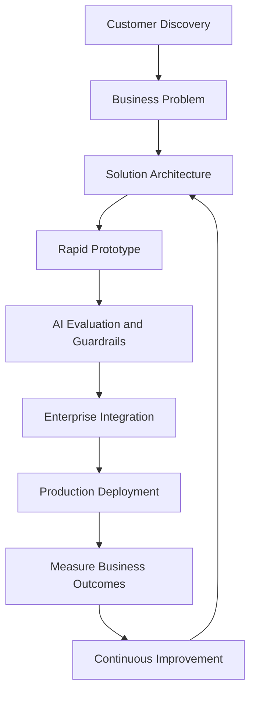
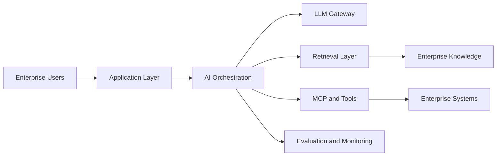

### Building at the Intersection of AI, Engineering and Business

---

## About Me

I am a software engineering professional with 15+ years of
experience across enterprise applications, software architecture,
distributed systems and full-stack engineering.

My current focus is Applied AI, Agentic AI and Forward Deployed
Engineering — connecting complex enterprise challenges with
practical, scalable and reliable technology solutions.

I believe successful AI engineering goes beyond building
prototypes. It requires understanding business problems,
designing the right architecture, integrating with existing
systems and measuring real-world outcomes.

## Core Engineering Focus

| Domain | Focus |
|---|---|
| Forward Deployed Engineering | Customer discovery, solution design, rapid prototyping and enterprise integration |
| Applied AI | LLM applications, RAG, structured outputs and AI evaluation |
| Agentic AI | Tool calling, MCP, agent orchestration and human-in-the-loop workflows |
| AI System Design | Security, reliability, observability and cost optimization |
| Distributed Systems | Microservices, event-driven architecture and scalability |
| Full Stack Engineering | Enterprise frontend and backend applications |

## Technology Ecosystem

### AI Engineering Focus

### Application Engineering

### Cloud, Data and Infrastructure

### Engineering Tools

## Forward Deployed Engineering Approach

## AI Architecture Focus

## Public Portfolio Roadmap

| Project | Engineering Focus |
|---|---|
| Enterprise RAG Platform | Retrieval, citations and grounded responses |
| Agentic AI Orchestrator | Agent workflows and tool execution |
| MCP Enterprise Connectors | Secure enterprise integrations |
| LLM Evaluation Framework | Quality, latency, reliability and cost |
| Production AI Copilot | End-to-end enterprise AI application |
| FDE Engineering Playbook | Discovery, architecture and deployment |

These are planned public reference implementations and
engineering case studies.

## Engineering Principles

- Understand the business problem before choosing technology.
- Design for measurable customer outcomes.
- Build for security, reliability and scalability.
- Evaluate AI systems continuously.
- Treat production deployment as an engineering responsibility.
- Make complex systems understandable and maintainable.

## Current Areas of Exploration

- Enterprise AI transformation
- Agentic workflows and multi-agent systems
- Model Context Protocol
- Context engineering
- AI evaluation and observability
- Human-in-the-loop automation
- Production AI architecture

## Connect With Me

- Portfolio: https://galabasivaprasad.com
- Location: Hyderabad, India
- Interests: Applied AI, FDE, AI Architecture and Distributed Systems

### Discover. Architect. Build. Deploy. Deliver Impact.

